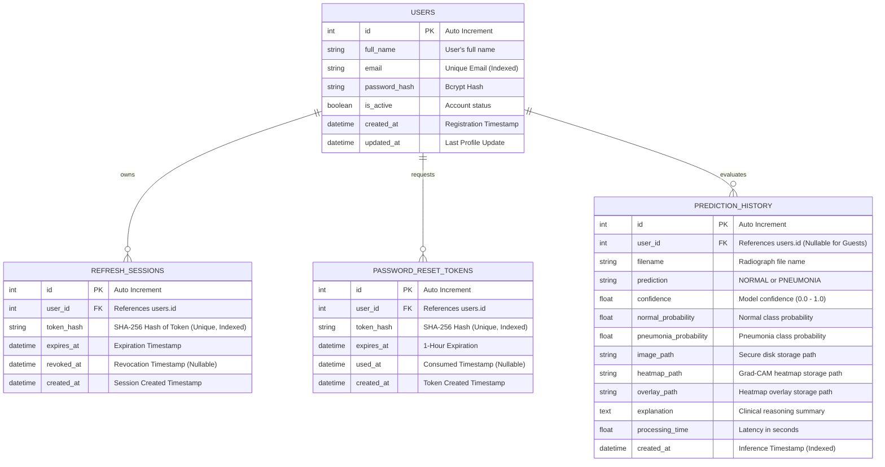

# Relational Database Schema Documentation

## 1. Entity Relationship Diagram

## 2. Table Specifications

### 2.1 `users`
- Stores user credentials, hashed passwords, and profile metadata.
- Email is indexed and constrained to be case-insensitively unique.

### 2.2 `refresh_sessions`
- Manages refresh token rotation.
- Rather than storing raw refresh tokens, stores a 256-bit SHA-256 digest (`token_hash`), preventing session compromise even if database dumps are leaked.

### 2.3 `password_reset_tokens`
- Tracks cryptographic single-use tokens valid for 60 minutes.
- When consumed, `used_at` is populated and all user sessions are invalidated.

### 2.4 `prediction_history`
- Stores individual scan records.
- User ownership is strictly enforced via foreign key `user_id`.
- Sensitive patient radiographs are saved into private disk storage (`backend/data/storage/`) rather than exposed publicly.

